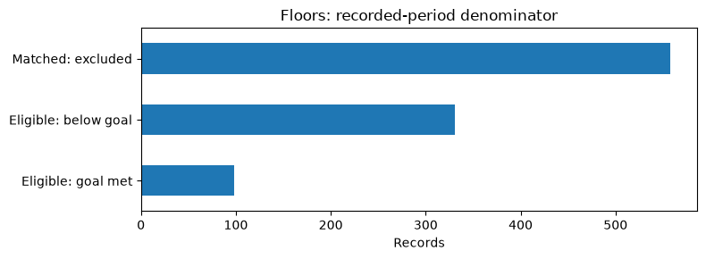
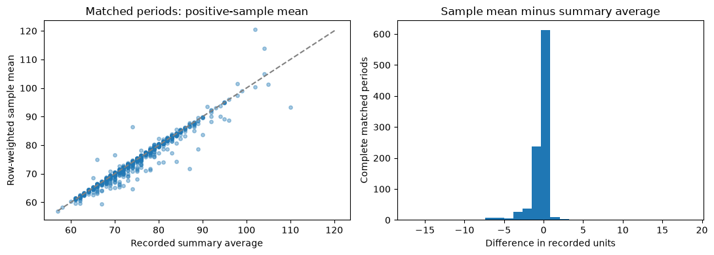
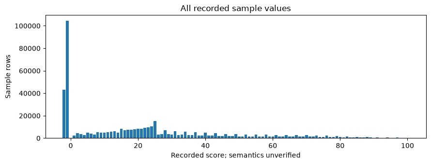
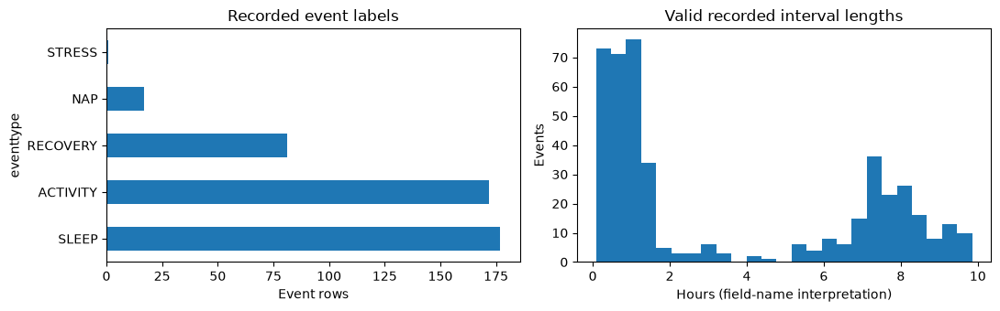
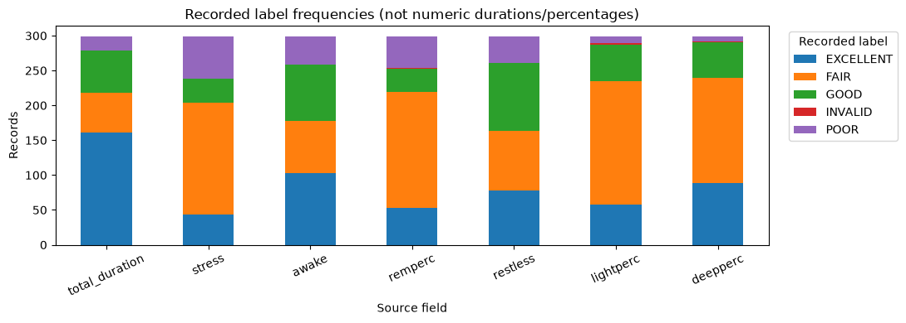
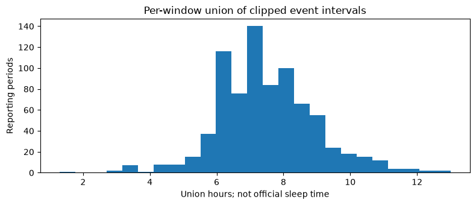

# Smartwatch internship project: complete exploratory data analysis

**Review date: October 22, 2026 · Presentation: Friday morning, October 23, 2026**

This project reviews all **13 database tables** to understand what the records mean, what is missing or potentially invalid, how recording coverage varies, and which tables can be compared safely. It is descriptive EDA, not a clinical assessment, causal study or validated predictive model.

This README brings together the verified findings, methods and data-handling decisions. Numbers come from saved executed notebook outputs and the local executed analysis artifacts, reconciled with [reviewed_table_relationships.md](reviewed_table_relationships.md) and [eda_presentation_notes.md](eda_presentation_notes.md). They describe the reviewed snapshots, not a permanent guarantee about a live database. Rounded values retain their original denominators. This documentation task did **not** rerun the database analyses or change their results.

## 1. What we learned, in plain language

1. **The tables contain different kinds of rows.** A summary row describes a labelled reporting period; a sample row is one timestamped value; an event row is an interval. Joining these raw tables together without checking their grain can multiply records and produce incorrect totals.
2. **Missing, zero and unusual codes are different things.** Floors are missing in 558 of 987 activity records. Stress samples contain negative values even though they have no nulls. Missing dates are not zero-activity dates, and a positive value is not automatically a validated measurement.
3. **Some relationships are well aligned, others have different coverage.** Steps, goals, activity and kilocalories have matching reviewed period keys. Heart-rate summaries have fewer periods than activity. Sleep summaries cover five participants, while sleep events cover eight. Body-battery events cover two participants, while samples cover seven.
4. **Recorded goals were met in a minority of eligible periods.** Steps met a positive recorded goal in **361/987 periods (36.58%)**. Floors met a positive goal in **98/429 eligible periods (22.84%)**; the 558 missing-floor records were excluded, not counted as failures or zeros.
5. **Samples do not automatically reproduce the source summaries.** Heart-rate sample minima/maxima agree with all 960 matched summaries, but 138 plain sample means differ from the summary average by more than one recorded unit. Stress agreement changes substantially when negative-code samples are excluded. The source averaging/filtering algorithms remain unknown.
6. **Sleep component names are misleading if read as numeric measurements.** `total_duration`, `remperc`, `lightperc` and the other component fields contain ratings such as `FAIR` and `GOOD`, not hours or percentages. Encoding those categories later would not recover the missing continuous measurements.
7. **A reporting window is not proof of full wear or complete observation.** Some windows are shorter/longer than 24 hours; some overlap; sample gaps and event spillover occur. These findings require source clarification, not automatic deletion or medical explanations.

**A sentence for the teacher:** “I established the meaning of a row, checked data quality and recording coverage, and validated period keys before comparing tables. The EDA identifies useful descriptive patterns and unresolved source questions; it does not prove why patterns occurred or validate a future model.”

This README embeds **six selected, non-identifying figures** from the executed analyses. Some figures contain multiple panels. The final six notebooks produced 12 inspected figures, and heart-rate samples produced three; the full figure sets remain in the executed artifacts. Only this selection is published under `docs/assets/`, without participant identifiers or raw sample traces. Captions state the relevant denominators and limits.

## 2. Scope, evidence and what was actually changed

### Completed

- Dedicated analyses of all 13 tables, with educational explanations and teacher-facing takeaways.
- Schema/type inspection; null, zero, negative/sentinel-candidate and duplicate checks; candidate-key and join-cardinality validation.
- Reporting-period, date-coverage, timestamp, cadence and interval-overlap diagnostics where applicable.
- Aggregate distributions, goals analysis, within-participant target changes, sample-to-summary comparisons and exploratory associations.
- Executed local notebooks and inspected plots; output-cleared source notebooks for the newly authored analyses; relationship and presentation documentation.

### Analysis operations versus cleaning

**The original database was not modified.** No rows were deleted, imputed, recoded, deduplicated or written back to it. Later notebooks use read-only queries; the sample/later-table investigations explicitly use read-only repeatable-read transactions. Earlier small-table loaders use `SELECT` queries but do not claim the same transaction-level snapshot guarantee.

Operations such as nonnegative-score filters, complete-case selection, timestamp collapse, centering and interval clipping create **temporary analysis subsets or derived columns in memory/SQL query results**. They are not a cleaned production dataset. Original values and exclusion counts remain visible. No global duplicate-resolution, sentinel replacement, outlier-removal, time-zone correction or category-encoding policy has been implemented.

No CSV export, RAG system, predictive model or slides were created. The pre-existing local modification to `stress_analysis.ipynb` was preserved rather than incorporated into the published evidence as a newly verified analysis change. This README adds documentation only.

### Evidence and privacy

The saved executed versions are the evidence for results; a check appearing in code alone is not treated as a verified finding. The documentation audit found executed outputs for all 13 reviewed tables and no saved execution errors. The 12 later analysis notebooks have executed local snapshots under ignored `.ipynb_checkpoints/<table>_analysis_local/<table>_analysis_executed.ipynb`; the original activity notebook retains its saved outputs. These ignored artifacts are not expected in a fresh Git clone. The last six-table phase executed 35 code cells and inspected 12 figures.

This README publishes aggregate findings only. It does not reproduce participant identifiers, individual records, participant-specific timestamp sequences, credentials or private-key locations. Individual case studies in the original activity exploration are summarized without identifying the participant. Existing notebook content was not rewritten by this documentation task.

## 3. Dataset inventory, grain and meaning confidence

All tables share these context fields:

| Field(s) | Role and confidence |
| --- | --- |
| `additional_id` | Candidate export/record identifier. Uniqueness is tested; it legitimately repeats across samples/events. It is not universally a sample or event key. |
| `sdv_user_id`, `sdv_group_id`, `sdv_data_type` | Participant/group/type context, used as categories/keys rather than continuous measurements. Their numeric values are not averaged to make substantive findings. |
| `calendar_date` | Recorded date label, parsed for analysis. Its timezone and whether it labels a reporting day, sleep night or another convention are unverified. |
| `start_measure_period_sec`, `end_measure_period_sec` | Recorded reporting bounds. Unix-second interpretation is a plausibility assumption tested against timestamps, not a verified source definition. |
| `duration_measure_period_sec` | Reported period length, provisionally seconds from the name. End-minus-start consistency is checked; duration is not asserted to be actual valid wear time. |
| `week_nr`, `week_day` | Source labels. ISO week/day matching is a diagnostic, not authority to overwrite the source convention. |

The counts below are reviewed raw table rows. “Periods” for sample/event tables are **derived distinct participant/date/start/end groups**, not additional raw rows or verified sleep episodes.

| Table / notebook | Rows | Participants | Grain; table-specific fields and unit/meaning confidence |
| --- | ---: | ---: | --- |
| [activity](activity_analysis.ipynb) | 987 | 8 | Reporting-period activity summary. `distance_in_meters`, `steps`, `floors_climbed`, `active_time_sec`, `moderate_intensity_duration_sec`, `vigorous_intensity_duration_sec`. Names suggest metres, counts and seconds; sensor/algorithm and complete-day semantics are not independently verified. |
| [steps](steps_analysis.ipynb) | 987 | 8 | Reporting-period `steps` and `steps_goal`, interpreted as recorded counts/target settings. Target scope and device accuracy remain unverified. |
| [goals](goals_analysis.ipynb) | 987 | 8 | Period target settings: `steps_goal`, `floors_goal`, `intensity_goal`. Steps/floors are provisionally counts. Intensity units, weighting and daily/weekly scope are unknown. |
| [kilocalories](kilocalories_analysis.ipynb) | 987 | 8 | Period estimates `active_kilocalories`, `bmr_kilocalories`. Names suggest kcal and active/basal-related estimates; algorithms, prorating and additivity are unverified. |
| [stress](stress_analysis.ipynb) | 987 | 8 | Scores `average_stress_level`, `max_stress_level`; durations `stress_duration_sec`, `rest_stress_duration_sec`, `low_stress_duration_sec`, `medium_stress_duration_sec`, `high_stress_duration_sec`, `activity_stress_duration_sec`; `stress_qualifier`. Score/qualifier rules and duration partitions are unknown; `_sec` is a provisional seconds interpretation. |
| [heart_rate_values](heart_rate_values_analysis.ipynb) | 961 | 8 | Period `min_heart_rate_min`, `max_heart_rate_min`, `avg_heart_rate_min`, `rest_heart_rate_min`. Beats/minute is a working field-name interpretation; suffix, aggregation window/weighting and resting algorithm need confirmation. |
| [heart_rate_sample](heart_rate_sample_analysis.ipynb) | 4,912,004 | 8 | Timestamped `heart_rate` at `sample_point_sec`; 960 derived periods. Units/timestamp convention and nominal sampling schedule are unverified. |
| [stress_level_sample](stress_level_sample_analysis.ipynb) | 460,975 | 8 | Timestamped `stress_level` at `sample_point_sec`; 981 derived periods. Score and negative-code meanings unverified. |
| [body_battery_sample](body_battery_sample_analysis.ipynb) | 315,848 | 7 | Timestamped `body_battery_value` at `sample_point_sec`; 708 derived periods. Source score meaning/scale unverified; not treated as a medically validated energy measurement. |
| [body_battery_activity_events](body_battery_activity_events_analysis.ipynb) | 448 | 2 | Labelled intervals: `eventtype`, `start_sec`, `duration_sec`, `bodybatteryimpact`; 178 derived periods. End is operationally start + duration. Seconds, impact units/sign/additivity and labels require source confirmation. |
| [overall_sleep](overall_sleep_analysis.ipynb) | 299 | 5 | Period `sleep_value` score and `sleep_qualifier`. Recorded numeric score and text labels are verified types; scale/algorithm/clinical meaning are not. |
| [sleep](sleep_analysis.ipynb) | 299 | 5 | Period component ratings: `total_duration`, `stress`, `awake`, `remperc`, `restless`, `lightperc`, `deepperc`. **Observed categorical text, not numeric durations or percentages.** |
| [sleep_level_events](sleep_level_events_analysis.ipynb) | 18,402 | 8 | Labelled intervals: `sleeptype`, `start_sec`, `end_sec`; duration derived as end − start, 797 periods. Stage algorithm, endpoints, timezone and night assignment unverified. |

SQL integer/SMALLINT types establish storage types, not physical or clinical validity. Pandas may represent nullable integer fields as floating point because of nulls; that is not evidence that the original measurement is continuous.

## 4. Methodology and concrete decisions

| Decision | What was done and why |
| --- | --- |
| Establish grain before statistics | Separate summaries, samples and intervals. Repeated record IDs in a sample/event table are expected and are not automatically duplicate observations. |
| Inspect every column | Record schema/type, missing counts and distinct counts. Descriptive statistics focus on measurement fields rather than numeric identifiers. |
| Retain nulls versus zeros | Missing floors, missing summaries and missing dates remain distinct from observed zero values. No imputation was performed. |
| Flag unusual values explicitly | Count negative/zero candidates and their exact values. Stress `−1`/`−2`, qualifier `unknown` and sleep `INVALID` retain their source labels; their meanings are not invented. |
| Keep extreme observations | Large steps, duration or score values are investigated with context; no outlier was removed solely for being large. |
| Validate candidate keys | Test record ID, participant/date and exact-period keys for nulls/duplicates. Sample keys additionally include timestamps; event candidates include interval bounds and label. |
| Use exact-period joins | Compare `sdv_user_id`, `calendar_date`, start and end together. Equal row counts or calendar dates alone do not establish correspondence. |
| Enforce cardinality | Use outer joins with `validate='one_to_one'` after key checks. Count unmatched records on both sides; skip ambiguous comparisons rather than silently deduplicate to force a join. |
| Verify context | Compare record IDs, groups and duration on matched periods; sample/event aggregation retains metadata-variation counts before a representative context value is used. |
| Aggregate before joining | Samples/events become one row per period before summary joins. Raw event × sample and event × summary joins are avoided because they can multiply records. |
| Keep comparisons operational | Positive/nonnegative filtering and complete-case criteria are stated per outcome. These are sensitivity subsets, not source-certified validity definitions. |
| Protect denominators | Report records in scope, eligible records, exclusions and achievements. Different missingness creates different denominators; a record-weighted rate is not a participant-weighted rate. |
| Handle targets safely | Goals must be present and strictly positive for ratios/achievement. Missing/negative steps or floors are excluded. Zero goals would not be silently successful and division by zero is not performed. |
| Handle target changes | Sort within participant; compare adjacent **observations**, excluding the first and missing pairs. A gap between dates does not locate the exact target-change day. |
| Keep alternate means separate | Compare all numeric samples, nonnegative samples and timestamp-collapsed nonnegative samples separately. SQL means ignore null numeric inputs, so counts are retained. Plain sample means are row-weighted, not time-weighted. |
| Count duplicate scopes separately | Exact full-row duplicates, within-period timestamp collisions/conflicts and cross-period timestamp repetition/conflicts are different diagnostics. No global conflict-resolution policy was applied. |
| Collapse timestamps only for stated diagnostics | Repeated timestamps are collapsed for gap calculation to avoid artificial zero-second intervals; stress timestamp-collapsed means are sensitivity calculations, excluding conflicts. Source rows are not deleted. |
| Separate gap types | Within-export-record cadence is separate from across-record gaps. Heart-rate samples also have a distinct participant-wide sequence with ambiguous record membership near shared timestamps. Later sample notebooks use explicitly labelled record-boundary gaps, not that same sequence estimator. |
| Avoid assumed cadence/nonwear | Modes/medians describe observed spacing. Long gaps and incomplete spans are not classified as nonwear or inactivity without source evidence. |
| Preserve interval arithmetic assumptions | Event diagnostics use half-open `[start,end)` intervals. Endpoint equality is not overlap; inclusive/exclusive source rules remain unknown. |
| Clip only for explicit diagnostics | Compare raw interval lengths, lengths clipped to reporting bounds and interval unions. Retain outside-window event counts; do not proportionally clip impact estimates or call unions official sleep/activity totals. |
| Check raw cross-period event overlap too | A participant-level sweep across exports ensures clipping does not hide overlaps between intervals assigned to different reporting periods. |
| Require complete duration sums | Use complete nonnegative inputs and `min_count`/explicit masks, preventing a missing component from silently becoming zero in a sum. Arithmetic equality is not a source definition. |
| Separate date coverage from wear | Coverage denominator is dates inside each participant's first-to-last observed span, not unknown enrolment time. First/last sample span is not continuous valid observation. |
| Treat timezone conversion as a diagnostic | Parse dates/timestamps for analysis but do not overwrite source labels or impose a local timezone. Different UTC/source dates can be expected under another convention. |
| Keep associations descriptive | Compare pooled Pearson/Spearman and within-participant-centered Pearson; use complete cases, show subset counts and participant-specific correlation distributions where defined. No p-values, causal effect or predictive validation is claimed. |
| Avoid unsupported score arithmetic | No official active+BMR total, intensity achievement, reconstructed resting HR, numeric sleep hours/percentages or additive body-battery impact is inferred. |
| Preserve source and privacy | Queries are read-only. Published new source notebooks clear outputs; ignored local executed artifacts preserve charts/results. README omits identifiers, individual records and secrets. |

### Correlation and weighting in plain language

Pooled correlation mixes within-person changes with differences between people. The within-participant calculation subtracts that participant's own subset mean from **both** variables before correlating the deviations. It removes mean-level differences but still weights participants with more records more heavily. It does not remove time trends, selective missingness, overlap, repeated-measure dependence or shared device inputs. Spearman describes rank association; Pearson describes linear association. Participant correlations are only calculated with at least three records and variation in both variables.

Each notebook states its own exclusions. Record-weighted rates/means and a distribution of participant-specific rates/medians answer different questions. Neither the number of samples nor the number of daily-labelled records is the number of independent people.

## 5. Validated relationships and unmatched periods

Every row below refers to a directly executed comparison. “A-only” and “B-only” keep the stated orientation. Sample/event rows are aggregated to period grain before these joins; the one-to-one statement does **not** apply to their raw rows.

| A | B | Matched periods | A-only | B-only | Additional evidence |
| --- | --- | ---: | ---: | ---: | --- |
| activity | steps | 987 | 0 | 0 | Recorded steps agree in all matches; compared ID/group/duration context agrees. |
| goals | steps | 987 | 0 | 0 | Recorded steps goals agree in all matches; context agrees. |
| goals | activity | 987 | 0 | 0 | Context agrees; floors eligibility checked separately. |
| kilocalories | activity | 987 | 0 | 0 | Context agrees. |
| kilocalories | steps | 987 | 0 | 0 | Context agrees; activity/steps consistency independently rechecked. |
| stress | activity | 987 | 0 | 0 | Context agrees. |
| heart_rate_values | activity | 961 | 0 | 26 | Same unmatched counts on participant/date; absence is not merely different period bounds. |
| aggregated heart_rate_sample | heart_rate_values | 960 | 0 | 1 | Context agrees; all paired sample min/max values agree. |
| aggregated stress_level_sample | stress | 978 | 3 | 9 | Context agrees; max/mean algorithms do not generally reproduce summaries. |
| aggregated body_battery_sample | aggregated body_battery_activity_events | 178 | 530 | 0 | Context agrees; two event participants are among seven sample participants. |
| overall_sleep | sleep | 299 | 0 | 0 | Same five participants; context agrees. |
| overall_sleep | aggregated sleep_level_events | 299 | 0 | 498 | All five summary participants occur among eight event participants; context agrees. |
| sleep | aggregated sleep_level_events | 299 | 0 | 498 | Context agrees; categorical component fields are not interval durations. |

These are not all possible pairwise comparisons. For example, sample-to-activity links may be **indirect through a reviewed summary relationship**. No fresh direct heart-rate-sample/activity, stress-sample/activity, sleep-event/activity or other unlisted join is claimed. Matching keys/values does not independently validate a sensor or establish a common source algorithm. Separate notebook snapshots are not one globally synchronized database snapshot.

## 6. Per-table verified findings

### 6.1 Activity

Evidence: [activity_analysis.ipynb](activity_analysis.ipynb), supplemented by the later steps/goals exact-period/context checks.

- **987 records, eight participants, 16 columns.** Floors are missing in **558/987 records (56.53%)**, available in **429**; **76 recorded floor values are zero**. Recorded floors have 50 distinct non-null values, median **6**, mean **9.853**, range **0–118**.
- The other five activity measurements examined have no nulls. Floor missingness is concentrated in some participants, whereas weekday missingness ranges **56.12%–57.04%**; weekday alone does not explain it. Device support, collection or export differences remain possibilities, not established causes.
- Recorded summaries are right-skewed, especially steps and moderate-intensity duration. Cohort aggregate statistics are:

| Measurement | Mean | Median | Minimum | Maximum |
| --- | ---: | ---: | ---: | ---: |
| steps | 6,802.25 | 5,302 | 0 | 47,025 |
| distance_in_meters | 6,651.42 | 4,386 | 0 | 44,783 |
| active_time_sec | 6,482.64 | 5,770 | 0 | 33,245 |
| moderate_intensity_duration_sec | 1,107.36 | 180 | 0 | 18,840 |
| vigorous_intensity_duration_sec | 671.55 | 0 | 0 | 16,740 |

- The notebook examined high-value records, participant averages and monthly patterns, without deleting extremes or treating unequal follow-up as fair participant rankings.
- Its case investigation found a sharp change in recorded activity accompanied by shorter/zero-heavy coverage, stream-specific end dates, missing dates and a brief internally regular HR window. Stress observations continued during some HR/body-battery gaps. This supports **different stream availability**, not a confirmed behavioral change, nonwear explanation or collection failure. Participant-specific records/dates are deliberately not reproduced here.
- Decisions: keep null floors, retain observed zeros, keep extremes pending source/context review, distinguish missing dates from zeros and qualify monthly/user comparisons by coverage. Minutes in plots are a seconds-to-minutes presentation conversion, not new source data.

**Reconciliation:** an early print statement labelled `.count()` as “null values”; its **429** is actually non-null count. The later `.isna()` result **558** is the missing count. Original prose/chart titles use “daily”; this README uses **recorded reporting period**, because later checks demonstrate non-24-hour windows and incomplete/unequal observation. Early “next table/key checks” notes are historical; the later notebooks completed those checks.

### 6.2 Steps

Evidence: [steps_analysis.ipynb](steps_analysis.ipynb).

- **987 records/eight participants**, no null steps/goals, no negative steps and no exact duplicate rows; tested record/date/period keys are unique/non-null. There are **20 recorded zero-step values**. All recorded steps goals are positive.
- Steps: mean **6,802.25**, median **5,302**, quartiles **3,151–8,851.5**, range **0–47,025**. Steps goals: mean **8,027.08**, median **8,000**, quartiles **5,985–10,000**, range **2,780–30,000**.
- All **987** records are eligible for positive-goal attainment: **361/987 (36.58%)** meet `steps >= steps_goal`. Exactly-24-hour sensitivity: **355/970 (36.60%)**. No goal exclusions happened in this snapshot, although the code explicitly guards missing/nonpositive goals and missing/negative steps.
- Attainment ratio `100 × steps / positive goal`: median **79.175%**, mean **89.732%**, range **0%–546.942%**. A ratio over 100 means the recorded count exceeds the target; it is not automatically capped. Participant-specific goal-meeting rates vary, so the pooled record rate is not an equally weighted participant rate.
- **970 windows are exactly 24 hours**, 16 shorter and one longer; all durations equal end minus start. Two windows overlap preceding windows. Observed-date coverage is **89.36%–100%** inside individual spans, with **16–250 observed dates**.
- Exact activity/goals matches and agreeing duplicated values are documented in section 5. Calendar labels are not assumed to be full days or independently validated wear days.

### 6.3 Goals

Evidence: [goals_analysis.ipynb](goals_analysis.ipynb).

- **987 records/eight participants**, no missing goal values, exact duplicates or tested key collisions. All three target fields are positive.
- `steps_goal`: **297 distinct values**, median **8,000**, range **2,780–30,000**.
- `floors_goal`: **10 in 865 records**, **20 in 122**. `intensity_goal`: **9,000 in 807**, **12,000 in 122**, **18,000 in 58**. Intensity units/weighting and daily/weekly horizon remain unknown; no comparison with activity seconds is made.
- Across **979 comparable adjacent observed-record transitions** (eight first records have no predecessor), steps goals change **381 times**: **178 increases**, **203 decreases**, involving **three participants**. All are positive-to-positive changes; two changes span date gaps. Six observation transitions in total are separated by more than one date. The exact change day and adaptive algorithm are not inferred.
- Floors/intensity targets have **no within-participant changes** in this snapshot; their overall variation is between participants.
- Floors achievement uses positive targets and nonmissing/nonnegative floors, retaining the 76 measured zeros: **98/429 eligible records (22.84%)**. **558** missing-floor records are excluded. Exactly-24-hour sensitivity: **98/427 (22.95%)**, with 543 excluded from 970 matched 24-hour records. The rate cannot describe the records with missing floors.
- Week labels differ from the ISO calendar-date diagnostic in **one week-number record** and **nine weekday records**. The labels were not overwritten; source convention needs confirmation.



**Figure 1 — The denominator changes the interpretation.** Of 987 matched periods, 429 have a positive floors goal and a nonmissing, nonnegative floor count: 98 meet the goal and 331 fall below it. The other 558 records have missing floors and are excluded, not counted as zero or failures. The 22.84% achievement rate applies to eligible recorded periods, not all days or people.

### 6.4 Kilocalories

Evidence: [kilocalories_analysis.ipynb](kilocalories_analysis.ipynb).

- **987 records/eight participants**, no nulls, exact duplicates or tested key collisions. Active kcal has **21 zeros**, no negatives; BMR is positive in all records.
- Active estimate: mean **399.563**, median **316**, quartiles **169–531**, range **0–2,381**. BMR estimate: mean **1,867.301**, median **1,795**, quartiles **1,653–2,059**, range **4–2,414**. These describe reporting windows, not certified daily expenditure.
- In exactly-24-hour windows, active/BMR medians are **319/1,801**; other-duration medians are **194/937**. Different windows must not be read as interchangeable complete-day totals.
- All **987** matched periods have nonmissing/nonnegative steps and active kcal. Pooled/centered Pearson: **0.610/0.671**. For **970 exactly-24-hour records**, **0.607/0.668**, pooled Spearman **0.586**. Restricting to positive values in both metrics leaves **952 records**, Pearson **0.595/0.654**.
- Participant-specific 24-hour Pearson correlations range **0.478–0.948**, median **0.695** (eight defined correlations). Heterogeneity, repeated records, unequal follow-up and potentially shared movement inputs prevent causal or independent validation claims.
- There are 970 exactly-24-hour windows, 17 other-duration windows and two overlaps; coverage is 89.36%–100% within observed spans. **Active + BMR is not labelled an official total**; definitions/additivity/prorating remain unknown.

### 6.5 Stress summaries

Evidence: the preserved executed [stress_analysis.ipynb](stress_analysis.ipynb) analysis; later uncommitted local edits are not newly certified by this README.

- **987 records/eight participants**, no exact duplicates or tested key collisions. **217 missing cells** occur despite a non-null average-score column.

| Field | Missing records | Other recorded-value finding |
| --- | ---: | --- |
| average_stress_level | 0 | 27 values of −1; 960 nonnegative values |
| max_stress_level | 27 | No zero/negative recorded values |
| stress_duration_sec | 27 | No zero/negative recorded values |
| rest_stress_duration_sec | 39 | No zero/negative recorded values |
| low_stress_duration_sec | 29 | No zero/negative recorded values |
| medium_stress_duration_sec | 31 | No zero/negative recorded values |
| high_stress_duration_sec | 42 | No zero/negative recorded values |
| activity_stress_duration_sec | 22 | No zero/negative recorded values |

- Average score median is **32**, range **−1–86**; recorded maximum-score median is **96**, range **32–100**. Descriptive all-value statistics retain potential sentinels. No complete pair has average above maximum.
- Qualifiers: **balanced 448**, **stressful 222**, **unknown 74**, **calm 72**, **calm_awake 53**, **balanced_awake 43**, **very_stressful 34**, **very_stressful_awake 23**, **stressful_awake 18**. All 27 negative averages are `unknown`; the label also occurs with **47 nonnegative averages**. Known/nonnegative status is not certified validity.
- At least one duration is missing in 38 `unknown`, five `very_stressful_awake`, four `balanced`, three `calm` and one `very_stressful` record; other listed qualifier groups have none. Missingness is not converted to zero.
- `low + medium + high = stress duration` in **943/943 complete nonnegative records**; 44 are excluded. `stress + rest + activity = period duration` in only **3/946 complete records**; the other 943 are below the window, none above. Median residual is **8,070 seconds**, maximum **73,980**. No individual recorded duration exceeds its window where present. These are arithmetic observations, **not proof of a mutually exclusive/exhaustive partition or missing wear time**.
- Average stress versus steps: all numeric scores **n=987**, pooled/centered Pearson **0.078/0.211**; exclude negatives **n=960**, **0.010/0.068**; nonnegative, exactly 24 hours **n=948**, **0.010/0.065**, Spearman **−0.039**. Excluding `unknown` qualifiers from nonnegative scores gives **n=913**, **0.027/0.080**. Requiring positive steps in 24-hour records gives **n=944**, **0.017/0.076**. These sensitivity subsets do not establish source validity.
- The 987 activity matches, 970 exactly-24-hour windows, 17 other-duration windows, two overlaps and coverage cautions are retained. No duration-category thresholds are reconstructed from score values.

### 6.6 Heart-rate summary values

Evidence: [heart_rate_values_analysis.ipynb](heart_rate_values_analysis.ipynb).

- **961 records/eight participants**. Minimum, maximum and average each have **one null in the same incomplete triple**; resting has none. No zero/negative recorded HR values, exact duplicates or tested key collisions occur.

| Field | Complete values | Median | Recorded range |
| --- | ---: | ---: | ---: |
| min_heart_rate_min | 960 | 52 | 30–96 |
| max_heart_rate_min | 960 | 129 | 67–202 |
| avg_heart_rate_min | 960 | 74 | 57–110 |
| rest_heart_rate_min | 961 | 56 | 37–96 |

- All **960 complete triples satisfy min ≤ average ≤ max**. Resting is below reported minimum in **34/960** complete comparisons and above maximum in **0**. The resting algorithm/window may differ; this is a source question, not automatically an invalidity or clinical finding.
- The outer activity join has **961 matches, 26 activity-only periods and no HR-only periods**. The participant/date join gives the same counts. The 26 absent summaries involve five participants, include **21 exactly-24-hour activity windows**, and have steps median **0**, range **0–12,781**. Absence is not explained solely by short windows or inactivity.
- Average versus steps uses **960** eligible records overall; **948** are exactly 24 hours, pooled/centered Pearson **0.106/0.387**, Spearman **0.098**. Participant-specific 24-hour Pearson range **0.276–0.722**, median **0.458**, eight defined correlations.
- Resting versus steps uses **961** records overall; **949** are exactly 24 hours, pooled/centered Pearson **−0.191/−0.004**, Spearman **−0.139**. A pooled association can largely reflect between-participant means rather than within-person co-variation.
- Positive-steps 24-hour sensitivity: average **n=945**, Pearson **0.110/0.398**; resting **n=946**, **−0.182/0.022**. All-HR-value validity and units remain unverified despite operational positive-value filtering.
- **949** windows are exactly 24 hours, 12 are not; two overlaps occur. Observed dates range 15–250; coverage is 93.04%–100% within spans.

**Historical wording:** this summary notebook says the sample table was unreviewed at that stage. The separate sample review below subsequently completed it; this is not a current project gap.

### 6.7 Heart-rate samples

Evidence: [heart_rate_sample_analysis.ipynb](heart_rate_sample_analysis.ipynb).

- **4,912,004 sample rows, 960 periods/eight participants**. All 12 fields are non-null; recorded HR values are positive, range **30–202**, with no exact duplicate rows or within-period timestamp collisions/conflicts.
- Each record ID maps to one participant/period. Participant/date/period/timestamp keys are unique, and record-ID/timestamp uniqueness follows from that mapping. Participant/timestamp alone is **not unique**: **480 timestamps are shared across periods**, with agreeing values. No global deduplication was performed.
- Samples lie within recorded bounds; **810 equal the period end**, none equals the start. All durations equal end minus start. **948 windows are exactly 24 hours**, 12 are not; two overlaps occur. **4,553,458** sample UTC dates equal the recorded calendar label; the difference is not automatically a timezone error.
- Samples per period: **4–6,000**, median **5,664**. Participants have **15–250 observed dates** and **61,352–1,387,204 sample rows**; span-based date coverage is **93.04%–100%**. First-to-last spans are not valid-observation or wear fractions.
- There are **4,911,044 within-export-record intervals** after spacing-only timestamp collapse. Observed mode/median/p90/p99 are **15 seconds**; **227 gaps exceed one hour**, maximum **57,975 seconds**.
- The distinct participant-wide sequence separately has **950 unambiguous across-record intervals**, including 126 above one hour, maximum **576,735 seconds**; **482 intervals have ambiguous record membership** near shared timestamps. Those are not folded into within-record cadence.
- Period join to HR summaries: **960 matches, one summary-only period, no sample-only periods**; context agrees for all matches. The absent sample period is not a zero HR value.
- Sample min/max exactly match **960/960** paired summaries. All-numeric and positive-only calculations are identical because every sample is positive. Means: **5/960 exactly equal**, **747/960 within 0.5**, **822/960 within one recorded unit**; **138** differ by more than one. Median signed sample-minus-summary difference **−0.127**, median absolute **0.320**, maximum absolute **18.458**. Rounding, weighting, filtering and averaging windows remain unknown. Resting HR is not reconstructed.
- The frequency plot uses SQL bins bounded to 1,500; it was **not truncated** in this run. Raw sample rows were not loaded into pandas. All sample/summary checks used one read-only repeatable-read snapshot.



**Figure 2 — A sample mean is not automatically the summary average.** These are 960 complete, context-agreeing matched periods, not raw sample traces. The diagonal denotes equality; 138 row-weighted sample means differ from the source average by more than one recorded unit (maximum absolute difference 18.458). Units, filtering, rounding and averaging rules remain unverified; the plot is not sensor or model validation.

### 6.8 Stress-level samples

Evidence: [stress_level_sample_analysis.ipynb](stress_level_sample_analysis.ipynb).

- **460,975 rows, 981 periods/eight participants**, all fields non-null. Recorded range **−2–100**; no zeros. There are **147,538 negative values**: **−1 in 104,279** rows and **−2 in 43,259**. Their meanings remain unverified.
- **108 exact duplicate rows** occur across **74 within-period timestamp keys**; no within-period score conflicts. Across periods, **164 timestamps repeat**, and **one participant/timestamp has conflicting scores**. No arbitrary conflict resolution or global deduplication was applied.
- Period sample counts **2–500**, median **480**. Metadata are internally unique. All timestamps lie within bounds; none equals the end. Durations equal end minus start. **962 periods are exactly 24 hours**, 19 are not; **four reporting windows overlap**. Span-based date coverage is 89.36%–100%, with 16–250 observed dates.
- Within-record intervals **n=459,886**: mode/median/p90/p99 **180 seconds**, **29 gaps above one hour**, maximum **55,440 seconds**. Separate record-boundary diagnostics: 973 boundaries, two negative overlaps, 19 above one hour, maximum **1,241,820 seconds**. These boundary gaps are not the HR notebook's distinct participant-wide sequence estimator.
- Stress summary join: **978 matches, three sample-only periods, nine summary-only periods**; context agrees in every match.
- All-value sample maxima versus nonnegative summary maxima: **90/951 exact**, **223/951 within one unit**, median absolute difference **4**, maximum **62**. Nonnegative-sample maxima have **948 complete pairs**, also 90 exact/223 within one; three matched periods have no eligible nonnegative sample maximum.
- All-sample means versus nonnegative reported averages: **951 complete pairs**, zero exact, **10 within one unit**, median absolute difference **8.146**, maximum **82.656**. Nonnegative means: **948 pairs**, **2 exact**, **857 within one unit**, median absolute difference **0.383**, maximum **17.211**.
- Timestamp-collapsed, non-conflicting nonnegative sensitivity: same 948 pairs, two exact/857 within one, median absolute difference **0.384**, maximum **17.211**. Duplicate weighting changes a period's nonnegative mean by at most **0.633** here. A closer result after filtering does not prove sentinel meanings or reproduce a verified source algorithm.



**Figure 3 — Non-null does not mean valid.** The frequency distribution includes all 460,975 recorded stress samples, including 147,538 negative values (−1 or −2). Their meanings are unknown, so the spikes are reported rather than labelled as a particular physiological state. Counts are sample-weighted and include the separately documented duplicate/export risks.

### 6.9 Body-battery samples

Evidence: [body_battery_sample_analysis.ipynb](body_battery_sample_analysis.ipynb).

- **315,848 rows, 708 periods/seven participants**. All fields non-null; observed score range **5–100**, no zero/negative values. This is not certification of a physiological score scale.
- No exact duplicates, within-period timestamp collisions or score conflicts occur. **91 participant/timestamps repeat across periods**, all with agreeing values. Metadata are unique within periods; raw and timestamp-collapsed nonnegative means agree here.
- Samples per period **2–500**, median **480**. All timestamps are within bounds; none equals the end. All durations equal end minus start. **695 windows are exactly 24 hours**, 13 are not; two reporting overlaps occur.
- Within-record intervals **n=315,140**: mode/median/p90/p99 **180 seconds**, **82 gaps above one hour**, maximum **43,740 seconds**. Record-boundary diagnostics: 701 boundaries, one negative overlap, 62 above one hour, maximum **576,900 seconds**.
- Observed dates **15–241 per participant**, with coverage **93.10%–100%** inside observed spans. Sample-span/window fractions are described as spans, not wear/valid-score coverage.
- The 448 body-battery events cover **178 periods/two participants**. All 178 event periods match samples, with agreeing context; **530 sample periods have no event match**. Both event participants are among the seven sample participants. Events are aggregated before joining. Missing event exports are not zero events, inactivity or evidence of an event effect.

### 6.10 Body-battery activity events

Evidence: [body_battery_activity_events_analysis.ipynb](body_battery_activity_events_analysis.ipynb).

- **448 events, 178 periods/two participants**, with no nulls, exact duplicates, nonpositive lengths, tested event-identity collisions or participant/start collisions. Recorded durations range **300–35,460 seconds**.
- Labels: **SLEEP 177**, **ACTIVITY 172**, **RECOVERY 81**, **NAP 17**, **STRESS 1**. These are source labels; small subgroup counts, especially a single event, cannot support broad conclusions.
- Under the declared half-open diagnostic, **122 intervals extend outside reporting bounds**, **171 cross UTC dates**, and 273 starts have UTC date equal to the label. No identical interval/label identity spans reporting periods, and no identical participant interval has different labels in this snapshot.
- Raw valid lengths sum to **5,699,100 seconds**. Clipping gives summed lengths **5,365,033** and summed per-period unions **5,362,633**, leaving **2,400 seconds of overlap excess** in one period. A separate raw sweep finds one row overlapping a prior same-period interval, **no cross-period event overlap**, and global raw union **5,696,700 seconds**. These are diagnostics, not official totals; reporting-window clipping does not redefine an event's source meaning.
- Reporting windows: **177 exactly 24 hours**, one other duration; one reporting-window overlap. Date coverage **98.25%–100%** within spans, 56–122 observed dates per participant.
- Impact values: **181 negative, 29 zero, 238 positive**, range **−22–79**, no missing values. No recharge/drain, additivity, proportional allocation on clipping or causal score-change interpretation is assumed. Impact/length plots are descriptive.
- All 178 event periods match sample aggregates, with 530 sample-only periods and agreeing context. The narrow two-participant event export is not generalized to the seven-participant sample cohort.



**Figure 4 — Events have their own grain and narrow coverage.** The 448 intervals cover only two participants and 178 reporting periods. The label and length distributions are descriptive source records; labels are not independently verified classifications. In this same dataset, 122 intervals extend outside their assigned reporting bounds and 171 cross UTC dates. These distributions do not establish complete coverage, impact meaning or a causal event effect.

### 6.11 Overall sleep

Evidence: [overall_sleep_analysis.ipynb](overall_sleep_analysis.ipynb).

- **299 records/five participants**, no null cells, exact duplicates or tested key collisions. Recorded score range **26–98**, median **76**; no zero/negative values. Source scale/algorithm are unknown.
- Qualifiers: **FAIR 126**, **GOOD 92**, **POOR 60**, **EXCELLENT 21**. Score distributions by qualifier and participant medians are descriptive; thresholds and medical meanings are not inferred.
- **293 windows exactly 24 hours**, six other-duration windows; no reporting-window overlap and all durations equal end minus start. Observed dates **11–121 per participant**, date coverage **78.57%–99.18%** inside spans.
- All 299 match `sleep`, with the same five participants and agreeing context. All 299 match event aggregates; **498 event periods have no overall-summary match**. Events span 797 periods/eight participants, including all five summary users. Missing scores are not zero scores/no sleep.

### 6.12 Sleep component ratings

Evidence: [sleep_analysis.ipynb](sleep_analysis.ipynb).

- **299 records/five participants**, no null cells, exact duplicates or tested key collisions. Every component has **zero numeric-parseable values**. The following are label counts, not durations/percentages:

| Field | EXCELLENT | GOOD | FAIR | POOR | INVALID |
| --- | ---: | ---: | ---: | ---: | ---: |
| total_duration | 161 | 61 | 57 | 20 | 0 |
| stress | 44 | 34 | 160 | 61 | 0 |
| awake | 103 | 80 | 75 | 41 | 0 |
| remperc | 53 | 33 | 166 | 45 | 2 |
| restless | 78 | 98 | 85 | 38 | 0 |
| lightperc | 58 | 52 | 177 | 10 | 2 |
| deepperc | 89 | 51 | 150 | 7 | 2 |

- The **same two records** account for `INVALID` in rem/light/deep rating fields; those labels are retained. No conversion to zero/null, imputation, ordinal encoding, label summation or percentage arithmetic was performed.
- Cross-tabs and overall-score distributions by `total_duration` label describe recorded co-occurrence; labels and scores may share an algorithm and do not establish causation or true sleep hours.
- Period checks and coverage match the overall-sleep findings: 293 exactly-24-hour windows, six other durations, no overlaps, 78.57%–99.18% observed-span coverage. All 299 match overall_sleep and event aggregates with agreeing context; events have 498 additional periods/eight rather than five participants.
- **Future category encoding cannot restore numeric hours or percentages.** One-hot encoding can represent category membership; a chosen ordinal code would impose an ordering/distance assumption. Either requires a defined future model/target and confirmed semantics. Encoding is deferred, not treated as completed cleaning.



**Figure 5 — These are ratings, not hours or percentages.** Each bar represents 299 records across five participants. Every component field contains text categories; none is numeric-parseable. The same two records contain INVALID in the rem/light/deep rating fields. Category encoding would represent labels, not recover numeric sleep duration or stage percentages.

### 6.13 Sleep-level events

Evidence: [sleep_level_events_analysis.ipynb](sleep_level_events_analysis.ipynb).

- **18,402 intervals, 797 periods/eight participants**, no null cells, exact duplicates, nonpositive lengths, tested event-identity collisions or participant/start collisions. Derived lengths range **60–18,600 seconds**.
- Recorded labels: **light 8,767**, **rem 4,978**, **awake 2,593**, **deep 2,064**. Algorithms remain unverified.
- **1,864 intervals extend outside their reporting bounds**, **729 cross UTC dates** under the half-open convention; 12,585 starts have UTC date equal to the calendar label. No exact interval/label identity spans periods, and no identical participant interval has different labels.
- Raw valid seconds total **23,189,062**. Clipping to reporting windows leaves **21,511,167**, equal to clipped union: no clipped within-period overlap. A separate raw sweep finds **no within- or cross-period interval overlap**; global raw union equals the raw sum in this snapshot.
- The unions include **awake**. They are **not official asleep duration**, complete-night coverage or a substitute for the categorical component fields. No event is silently deleted because it crosses midnight or its assigned reporting bound.
- **787 windows exactly 24 hours**, ten other durations; no reporting-window overlap; all durations equal end minus start. Observed dates **11–240**, coverage **58.8%–99.18%** inside individual spans.
- Each summary table matches **299 periods**, with **498 event-only periods** and no summary-only periods; all five summary participants occur among eight event participants. Context agrees after period aggregation; no raw interval join multiplies summaries.



**Figure 6 — An interval union is a diagnostic quantity.** The 797 event reporting periods cover eight participants. The plotted union clips intervals to each reporting window under the declared half-open convention and counts overlapping time once. Labels include awake, 1,864 intervals extend outside their reporting bounds, and source night/window semantics remain unknown. These values are not official asleep duration or wear time; the 299 sleep summaries cover only a subset of these periods.

## 7. Time, cadence, overlap and coverage: reconciled interpretation

### Reporting windows are not full days

For steps/goals/kilocalories/stress, the reviewed 987-record windows include 970 exactly 24 hours, 16 shorter and one longer. The steps duration table ranges from five minutes to 25 hours, including two 23-hour windows and one 25-hour window. Daylight saving is a **possible** explanation for some lengths, not a verified attribution without source timezone documentation. Partial windows must not be silently scaled to daily totals.

Other tables have different counts because their export coverage differs. HR summaries have 949 exactly-24-hour windows; HR sample periods 948; stress samples 962; body-battery samples 695; body-battery events 177; each sleep summary 293; sleep events 787. Those are actual table-specific denominators, not inconsistent estimates of one common set of records.

An overlap in reporting windows is different from duplicate sample timestamps or overlapping event intervals. For example, body-battery reporting windows overlap, while the raw event sweep found no cross-period event overlap. Sleep events spill outside reporting windows but show no raw interval overlap in the checked snapshot. Both kinds of checks are needed.

### UTC conversion is not a correction

Where reporting-start UTC/date checks were performed, the converted start date did not equal the recorded calendar label. Sample UTC dates can agree for much of a reporting period while its start belongs to the previous UTC date. That is not a contradiction or proof of an error; a local-midnight label is one possible convention. No timezone was guessed, labels were not overwritten, and dates were not used as sole comparison keys. UTC cross-midnight diagnostics do not establish local-night boundaries.

### Coverage has a limited denominator

`observed dates / (last observed date − first observed date + 1)` describes coverage **inside an observed span**. It excludes time before/after that span and cannot infer enrolment, expected reporting or actual wear. Window length, sample count, first-to-last sample span and gap statistics are complementary diagnostics, not interchangeable measures of valid measurement time. Case-specific UTC-date checks in the original activity notebook and reporting-label coverage in later notebooks therefore need not have identical counts.

## 8. Exploratory associations at a glance

The fuller sensitivity results and denominators are in section 6. These selected exactly-24-hour complete-case subsets show why pooled and within-participant statements must be separated:

| Comparison with recorded activity steps | Eligible periods | Pooled Pearson | Pooled Spearman | Within-participant-centered Pearson |
| --- | ---: | ---: | ---: | ---: |
| active kcal, nonnegative metrics | 970 | 0.607 | 0.586 | 0.668 |
| average stress, nonnegative score/steps | 948 | 0.010 | −0.039 | 0.065 |
| average HR, positive HR/nonnegative steps | 948 | 0.106 | 0.098 | 0.387 |
| resting HR, positive HR/nonnegative steps | 949 | −0.191 | −0.139 | −0.004 |

All four subsets include eight participants. More rows do not create more independent participants. Shared device algorithms, irregular observations, overlapping exports and selective missingness can affect associations. No hypothesis-test significance, causal direction, general-population effect or model accuracy is inferred. A near-zero association is not evidence that every participant has no relationship, and a larger one is not a causal effect.

## 9. Reconciliations and common misreadings

- **“All tables have 987 rows, so they match.”** False as a method; some tables have different counts, and matching was established by keys/cardinality, not lengths.
- **“No nulls means clean data.”** Stress samples have no nulls but many negative codes; sleep ratings include INVALID. Positive values still require source validity definitions.
- **“Duplicate rows are all the same issue.”** Stress has 108 exact repeats; heart-rate/body-battery streams also have cross-period timestamp repetition without exact full-row duplicates. Conflict scope matters.
- **“Samples reproduce the summaries.”** HR min/max agree, means do not always; stress maxima/means often differ. Algorithms/filtering/weighting remain unknown.
- **“The one summary-only HR period means zero HR.”** No. An absent sample group is not a numeric measurement.
- **“Three sample-only stress periods and nine summary-only stress periods contradict 981 versus 987.”** They are consistent: 978 common periods plus each side's unmatched periods. They are not silently merged by date alone.
- **“Sleep has only five users, so events must also have five.”** No. Events have eight and 498 extra periods; the summaries represent a subset.
- **“total_duration/remperc are numeric because of their names.”** Observed values are ratings. Encoding does not recover continuous measurements.
- **“A union of sleep-level events is time asleep.”** It includes awake and uses a diagnostic endpoint/clipping convention; it is not an official total.
- **“Duration equality proves full observation.”** End-minus-start equality is bookkeeping, not valid-sample/wear coverage; stress duration sums also do not exhaust most windows.
- **“A long gap proves the watch was not worn.”** Missing observation is established; its cause is not.
- **“Reported 15/180 seconds is a confirmed device setting.”** It is observed mode/median spacing only, with long gaps also present.
- **“Nonnegative filtering cleaned the dataset.”** It defined particular analysis subsets; raw database values remain unchanged.
- **“The whole project used one database snapshot.”** Only specified individual notebooks did; cross-notebook results come from separate reviewed snapshots.

## 10. Notebook navigation and safe reproduction

The inventory links all 13 notebooks. A useful reading order is activity → steps → goals → kilocalories → stress → HR summaries → HR samples → stress samples → body-battery samples → body-battery events → overall sleep → sleep ratings → sleep-level events. The notebooks are independent analyses except for the original activity loader dependency noted below.

### Existing local environment

The project has an existing `env` Python environment. The documentation check confirmed the required local modules are available: pandas, NumPy, Matplotlib, SQLAlchemy, python-dotenv, psycopg, nbformat, nbclient and ipykernel, with JupyterLab/notebook frontends. No package installation or global environment change was performed for this README.

From PowerShell in the existing local project:

```powershell
Set-Location 'J:\data analysis for imdadul'
.\env\Scripts\python.exe -m jupyterlab
```

Open the desired notebook, select the existing project environment/kernel and run cells in order from the project directory. Database access is read privately from the local `.env` using `DATABASE_URL`; do not print it, paste it into a notebook, commit it or add it to documentation. A fresh clone requires separately authorized access to the source database and a private connection configuration; it cannot reproduce results from repository files alone.

Later analysis notebooks load only their required summary tables or use server-side sample aggregation. Explicit read-only transactions/statement timeouts appear in the sample/later-table notebooks; read their setup first. Some aggregate sorts over millions of samples can take minutes even though only bounded results reach pandas. The final cleanup cell rolls back the read-only transaction and closes connections. If execution is interrupted or fails before cleanup, close/restart the kernel or run the applicable cleanup; do not modify the database to make a check pass.

**Legacy activity dependency:** `activity_analysis.ipynb` invokes `data_profile_generator.ipynb`, which loads all 13 tables, including the large streams, and displays raw examples. It is **not** a prerequisite for the later dedicated notebooks and should not be run merely to obtain one table. Its saved outputs are available for presentation review. The original dependency/raw displays were not rewritten by this documentation task; review execution/privacy implications before rerunning it.

### Local results versus published sources

The newly authored published source notebooks have cleared outputs. Ignored local executed snapshots/charts preserve the evidence for the reviewed run, and task deliverables also provided executed copies. `.ipynb_checkpoints` artifacts, the environment and `.env` are not data dependencies supplied by a fresh clone. Do not publish local artifacts without checking for identifiers/raw records. This README does not certify that every pre-existing file or user edit is sanitized.

To verify a rerun, check execution errors, key/denominator reports, unmatched counts and generated plots before accepting any conclusion. If the live data change, update results/evidence and this README together; do not force the data to match the recorded counts.

## 11. Verification status and boundaries of the audit

- All 13 tables have saved executed analysis evidence. The original activity notebook has 23 executed code cells plus an empty unexecuted placeholder; the 12 subsequent analyses have 73 executed code cells in total, with no saved error outputs in the reviewed artifacts. These are execution-evidence counts, not independent statistical tests or a new full rerun.
- The final six-table phase validated notebook structure, compiled source cells, checked successful execution, inspected 12 figures and confirmed source outputs were cleared while executed copies remained ignored.
- This README audit cross-checked all 13 notebook sources, saved outputs, relationship notes and presentation notes. It corrected terminology in documentation rather than modifying source data or existing notebooks. The preserved local stress edit is outside the published verified-result baseline.
- All analysis stages through the six-table completion were committed/pushed and verified against live remote `main` at analysis commit **`058bfe9`**. This README's own commit/push is verified separately after creation; its commit is not hard-coded here to avoid a self-referential stale hash.
- “Complete EDA” means the requested initial descriptive review is complete. It does not mean source semantics, missing-data mechanisms, clinical validity or model readiness have been resolved.

## 12. Questions that remain for the data owner

| Area | Required clarification |
| --- | --- |
| Reporting/calendar conventions | Timestamp epoch/units, timezone, date/night labels, ISO versus source week/day conventions, inclusive/exclusive bounds, intended meaning of partial/23/25-hour windows. |
| Observation coverage | Reporting window versus valid measurement/wear time; enrolment dates; expected reporting dates; reason for unequal stream/cohort/export coverage. |
| Stress | Mean/max scale and aggregation rules; meanings of −1/−2, unknown and awake-qualified labels; how duration categories are defined, overlap and cover the window. |
| Heart rate | Units/suffix meaning, sample filtering and weighting/rounding, min/max/average windows, resting estimation window/algorithm, missing-summary rules. |
| Body battery | Score and impact units/ranges/meaning, event labels, impact additivity, interval assignment and why events cover fewer participants/periods. |
| Goals | Daily/adaptive/other target scope, authoritative table if disagreement occurs, intensity units/weighting and daily versus weekly horizon, zero/sentinel conventions. |
| Kilocalories | Active/BMR definitions, algorithm, prorating, completeness and whether/when they are additive. |
| Sleep | Overall score/qualifier rules, component-label meanings/INVALID, availability of actual continuous duration/percentages, stage algorithm, awake inclusion and night-to-period assignment. |
| Duplicates/conflicts | Intended export identity, policy for repeated/overlapping periods, exact duplicates and conflicting cross-period timestamp values. |

## 13. Deferred work and a justified route toward a future model

In the reviewed and published EDA baseline, no CSV export, RAG, model fitting, train/test evaluation or model-oriented category encoding has been performed. Those remain separate tasks, not unfinished parts silently assumed to be complete. Preserved user-local unpublished edits are outside this verification statement.

Before a future model:

1. **Define the question and prediction time.** Specify the target, intended users, available-at-prediction features and a meaningful outcome/metric; descriptive correlations do not select a valid target by themselves.
2. **Obtain source semantics.** Resolve score/code/label definitions, time windows and actual duration/percentage availability. Category encoding represents labels; it cannot reconstruct missing numeric sleep measurements. Do not assign arbitrary ordinal distances or treat source-defined outcomes as independently verified truth.
3. **Define the analysis cohort and grain.** Decide whether one example is a participant-period, episode or another unit. Use validated joins and coverage criteria, document unmatched/excluded records, and consider whether the five-/two-participant exports can support the proposed task.
4. **Agree a reproducible quality policy.** Resolve sentinels, INVALID values, exact duplicates, cross-period timestamp conflicts, overlaps, timezone/endpoint rules and missingness. Keep source tables immutable; create versioned derived data with provenance and exclusion flags only under a separately authorized implementation.
5. **Prevent leakage.** Do not randomly split neighboring samples or duplicate/overlapping exports across train/test. Choose participant/time-aware splits appropriate to the use case, keep entire related periods together, and check whether target and candidate features share a source algorithm or future information.
6. **Fit transformations only on training data.** Any encoding, imputation or scaling must follow confirmed semantics and the chosen task, retain unknown/missing states explicitly and avoid learning from held-out observations.
7. **Start with an honest baseline and feasibility assessment.** Only eight participants exist in the broadest reviewed cohort; large sample counts do not resolve small-person generalization. Compare to simple baselines, disclose subgroup/coverage limits and assess whether additional participants or external validation are necessary before interpreting performance.

**Final presentation message:** “The EDA tells us what was recorded, where quality and coverage differ, and which comparisons are defensible. It gives a documented basis for asking the right source questions and designing a future modelling task; it does not itself validate a model or explain causes.”
